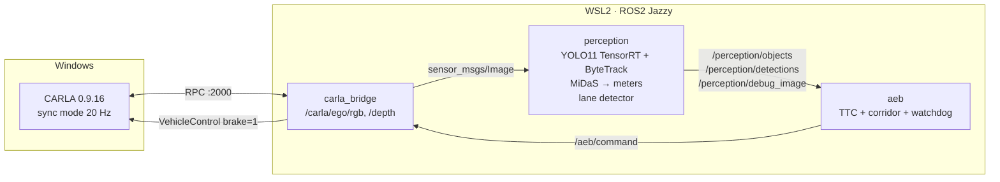

# Autonomous Driving Perception Stack

Camera-only perception that **detects, tracks and ranges** vehicles and pedestrians, finds the ego lane, and
**brakes the car** in the CARLA simulator through ROS2 when a collision is imminent. Models are exported
to ONNX and TensorRT and benchmarked on a 4 GB laptop GPU.

| | |
|---|---|
| Detection | YOLO11-s fine-tuned on CARLA ground truth (Town01/03/04/05), tested once on unseen Town02 |
| Tracking | ByteTrack vs BoT-SORT, scored with MOTA / IDF1 against CARLA ground-truth IDs |
| Lanes | Classical OpenCV pipeline **vs** LR-ASPP MobileNetV3 segmentation, scored on held-out towns and weather |
| Distance | Flat-ground geometry (default) vs MiDaS monocular depth calibrated to meters with CARLA's depth camera |
| Decision | Time-to-collision AEB with ego-lane gating, hysteresis and a perception watchdog |
| Runtime | CARLA 0.9.16 → ROS2 Jazzy nodes → brake command; PyTorch / ONNX Runtime / TensorRT FP16 / INT8 |
| Tracking of experiments | Weights & Biases |

## Results

Every number is written by a script into `reports/` (nothing is typed by hand).

| Question | Script | Result |
|---|---|---|
| How accurate is the detector on an unseen town? | `perception.eval_detection` | CARLA-tuned YOLO11s mAP50-95 **0.339** (95% CI 0.324-0.355) vs COCO YOLO11s 0.217 (0.205-0.230); pedestrian 0.245 vs 0.184, vehicle 0.434 vs 0.249. But at conf 0.3 the tuned model's pedestrian recall is *lower* (0.77 vs 0.83 under 15 m, 0.41 vs 0.53 at 15-30 m): `reports/detection_eval.json` |
| How much faster is TensorRT, and what does it cost? | `perception.optimize.benchmark` | `reports/benchmark.md` |
| How good is tracking? (MOTA, IDF1, ID switches) | `perception.eval_tracking` | Town02, COCO YOLO11s: BoT-SORT MOTA **0.36**, IDF1 0.57, 35 ID switches vs ByteTrack 0.21, 0.39, 81. Recall is the limit (0.49 / 0.37): `reports/tracking_*.json` |
| Classical vs learned lanes (F1 at 5 px, latency) | `perception.lanes.evaluate` | Town02: learned LR-ASPP F1 **0.884** (21 ms) vs classical 0.148 (13 ms). Without the yellow-paint town in training: 0.630, so paint colour is the main domain gap: `reports/lanes_comparison_*.json` |
| How far off are distance estimates, by range? | `perception.depth.evaluate` | Median relative error on Town02, 0-10 / 10-20 / 20-40 / 40-80 m: flat-ground **6.7 / 7.4 / 6.8 / 3.7 %** vs calibrated MiDaS 24 / 18 / 48 / 62 %: `reports/depth_eval.json` |
| **Does the car stop in time?** Euro NCAP-style CPNA-25 / CPFA-50 / CCRb at 20-40 km/h: avoided rate, speed reduction, reaction time | `carla_tools/run_scenarios.py` | Not run yet: the closed-loop runs are the next step |

## Architecture



The ego drives on Traffic Manager autopilot that is configured to **ignore pedestrians and vehicles**, so the only
thing that can stop the car is this stack.

### Design decisions
- **One pipeline, three front-ends.** `perception.pipeline.PerceptionPipeline` is used unchanged by the offline
  evaluators, the direct CARLA loop and the ROS2 node, so benchmarks measure the same code that drives the car.
- **Ground truth from the simulator.** `carla_tools/record_dataset.py` saves pixel-perfect depth, lane masks
  and actor IDs, which turns lane, depth and tracking quality into measurable numbers.
- **TTC from a line fit, not two-frame differencing.** Monocular depth is noisy, and a least-squares slope over 8 frames is stable.
- **Fail-safe defaults.** If perception stops publishing for 0.5 s, the AEB node brakes. Brake has 15-frame hysteresis to avoid chatter.
- **Oracle ablation.** `--oracle-depth` swaps MiDaS for ground-truth depth, isolating how much of each failure comes
  from depth vs detection.

## Quick start
1. **Train the detector** on CARLA ground truth (after recording the towns in step 4 and converting them with
   `perception.data.carla_to_yolo`): `python -m perception.train_detector --data data/carla_yolo/data.yaml --epochs 40 --batch 8`,
   then score it once on the unseen town: `python -m perception.eval_detection --seq data/carla/Town02_test --model coco=yolo11s.pt --model carla=models/yolo11s_carla.pt`.
2. **Environment:** follow [docs/SETUP.md](docs/SETUP.md) (CARLA on Windows, ROS2 Jazzy in WSL2).
3. **Optimize and benchmark:**
   ```bash
   python -m perception.optimize.benchmark --weights models/yolo11s_carla.pt --data data/carla_yolo/data.yaml
   ```
4. **Record synthetic data, then evaluate lanes, depth and tracking:**
   ```bash
   python carla_tools/record_dataset.py --town Town03_Opt --spawn 0 --width 800 --height 450 --out data/carla/Town03_clear
   python carla_tools/record_dataset.py --town Town03_Opt --weather MidRainyNoon --seed 1 --width 800 --height 450 --out data/carla/Town03_rain
   python carla_tools/record_dataset.py --town Town02_Opt --weather WetCloudySunset --seed 2 --vehicles 50 --walkers 100 --width 800 --height 450 --out data/carla/Town02_test
   python -m perception.lanes.seg_model --train data/carla/Town03_clear data/carla/Town03_rain --val data/carla/Town02_test
   python -m perception.lanes.evaluate --seq data/carla/Town02_test
   python -m perception.depth.evaluate --calib data/carla/Town03_clear --test data/carla/Town02_test --write-config
   python -m perception.eval_tracking --seq data/carla/Town02_test --weights models/yolo11s_carla.engine
   ```
5. **Closed-loop safety test (Euro NCAP-style scenarios) and demo video:**
   ```bash
   python carla_tools/run_scenarios.py --scenario cpna25 --speeds 20,30,40 --trials 5 --video reports/demo_cpna25.mp4
   python carla_tools/run_scenarios.py --scenario cpfa50 --speeds 20,30,40 --trials 5
   python carla_tools/run_scenarios.py --scenario ccrb --speeds 30,40 --trials 5
   ```
   | Scenario | What happens (if the car does not brake) |
   |---|---|
   | CPNA-25 / CPNA-75 | Adult walks in from the kerb side at 5 km/h and is hit at 25% / 75% of the car's width |
   | CPFA-50 | Adult walks in from the far side at 8 km/h and is hit at the centre of the bumper |
   | CCRb | The lead car ahead at the same speed brakes as hard as it can |

   The pedestrian is released at exactly the moment that makes an un-braked car hit them, so every avoided collision
   is the AEB's doing. The score per test speed is the avoided rate and the mean speed reduction, which is the basis of
   Euro NCAP's AEB score up to 40 km/h. Speeds and overlaps follow the protocol, but the geometry is simplified, so
   these are Euro NCAP-*style* results, not a rating.
6. **Through ROS2:** `ros2 launch perception_ros perception.launch.py scenario:=cpna25`

## ROS2 interface
| Topic | Type | Publisher |
|---|---|---|
| `/carla/ego/rgb` | `sensor_msgs/Image` (bgr8) | carla_bridge |
| `/carla/ego/depth` | `sensor_msgs/Image` (32FC1, m) | carla_bridge |
| `/carla/ego/speed` | `std_msgs/Float32` (m/s) | carla_bridge |
| `/perception/detections` | `vision_msgs/Detection2DArray` | perception |
| `/perception/objects` | `std_msgs/String` (JSON: id, class, box, distance, corridor) | perception |
| `/perception/debug_image` | `sensor_msgs/Image` | perception |
| `/perception/latency_ms` | `std_msgs/Float32` | perception |
| `/aeb/command` | `std_msgs/Int8` (0 cruise, 1 warn, 2 brake) | aeb |
| `/aeb/status` | `std_msgs/String` (JSON) | aeb |

## Tests
```bash
python -m pytest     # AEB rules, TTC, depth calibration math, ground-plane geometry, lane detector (CPU only)
```

## Limitations
MiDaS depth degrades beyond ~20 m, so flat-ground geometry is the default; it assumes a flat road and will fail on
hills. Everything is measured in simulation only: there is no real-world (sim-to-real) result yet. Tracking recall is
below 0.5 on the test town, and the tracker comparison was made on that town, not on a separate validation town.
The fine-tuned detector raises mAP but misses more pedestrians at its operating confidence, which is what the AEB
needs most; the threshold is being re-chosen on validation frames (`eval_detection`). The AEB has no notion of object heading or velocity vectors (it only uses the
closing speed along the line of sight). This is a research prototype, not a safety-certified system.
