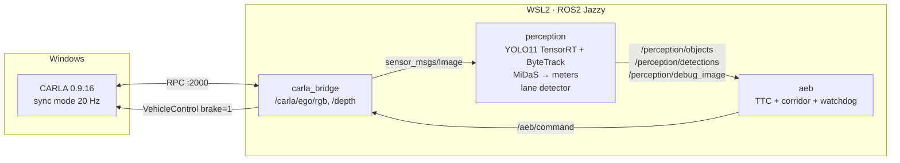

# Autonomous Driving Perception Stack

Camera-only perception that **detects, tracks and ranges** vehicles and pedestrians, finds the ego lane, and
**brakes the car** in the CARLA simulator through ROS2 when a collision is imminent. Models are exported
to ONNX and TensorRT and benchmarked on a 4 GB laptop GPU.

| | |
|---|---|
| Detection | YOLO11-s fine-tuned on BDD100K (10 classes) |
| Tracking | ByteTrack (compared with BoT-SORT), scored with MOTA / IDF1 against CARLA ground-truth IDs |
| Lanes | Classical OpenCV pipeline **vs** LR-ASPP MobileNetV3 segmentation, scored on held-out towns and weather |
| Distance | MiDaS monocular depth calibrated to meters with CARLA's depth camera, vs flat-ground geometry |
| Decision | Time-to-collision AEB with ego-lane gating, hysteresis and a perception watchdog |
| Runtime | CARLA 0.9.16 → ROS2 Jazzy nodes → brake command; PyTorch / ONNX Runtime / TensorRT FP16 / INT8 |
| Tracking of experiments | Weights & Biases |

## Results

Every number is written by a script into `reports/` (nothing is typed by hand).

| Question | Script | Result |
|---|---|---|
| How accurate is the detector? (mAP50-95, per class) | Kaggle notebook / `yolo val` | _…_ |
| How much faster is TensorRT, and what does it cost? | `perception.optimize.benchmark` | `reports/benchmark.md` |
| How good is tracking? (MOTA, IDF1, ID switches) | `perception.eval_tracking` | _…_ |
| Classical vs learned lanes (F1, latency, rain/night) | `perception.lanes.evaluate` | _…_ |
| How far off are distance estimates, by range? | `perception.depth.evaluate` | _…_ |
| **Does the car stop in time?** (collision rate, min gap, reaction time over N trials) | `carla_tools/run_scenarios.py` | _…_ |

## Architecture



The ego drives on Traffic Manager autopilot that is configured to **ignore pedestrians and vehicles**, so the only
thing that can stop the car is this stack.

### Design decisions
- **One pipeline, three front-ends.** `perception.pipeline.PerceptionPipeline` is used unchanged by the offline
  evaluators, the direct CARLA loop and the ROS2 node, so benchmarks measure the same code that drives the car.
- **Ground truth from the simulator.** `carla_tools/record_dataset.py` saves pixel-perfect depth, lane masks
  and actor IDs, which turns lane, depth and tracking quality into measurable numbers.
- **TTC from a line fit, not two-frame differencing.** Monocular depth is noisy, and a least-squares slope over 8 frames is stable.
- **Fail-safe defaults.** If perception stops publishing for 0.5 s, the AEB node brakes. Brake has 15-frame hysteresis to avoid chatter.
- **Oracle ablation.** `--oracle-depth` swaps MiDaS for ground-truth depth, isolating how much of each failure comes
  from depth vs detection.

## Quick start
1. **Train the detector** on Kaggle: import `notebooks/kaggle_train_yolo.ipynb`, add a BDD100K input, Run All, then
   copy `models/yolo11s_bdd.pt` into `models/`.
2. **Environment:** follow [docs/SETUP.md](docs/SETUP.md) (CARLA on Windows, ROS2 Jazzy in WSL2).
3. **Optimize and benchmark:**
   ```bash
   python -m perception.optimize.benchmark --weights models/yolo11s_bdd.pt --data data/bdd_yolo/data.yaml
   ```
4. **Record synthetic data, then evaluate lanes, depth and tracking:**
   ```bash
   python carla_tools/record_dataset.py --town Town03 --out data/carla/Town03_clear
   python carla_tools/record_dataset.py --town Town05 --weather HardRainNoon --out data/carla/Town05_rain
   python carla_tools/record_dataset.py --town Town10HD_Opt --weather WetCloudySunset --out data/carla/Town10_test
   python -m perception.lanes.seg_model --train data/carla/Town03_clear data/carla/Town05_rain --val data/carla/Town10_test
   python -m perception.lanes.evaluate --seq data/carla/Town10_test
   python -m perception.depth.evaluate --calib data/carla/Town03_clear --test data/carla/Town10_test --write-config
   python -m perception.eval_tracking --seq data/carla/Town10_test --weights models/yolo11s_bdd.engine
   ```
5. **Closed-loop safety test and demo video:**
   ```bash
   python carla_tools/run_scenarios.py --scenario pedestrian_crossing --trials 10 --video reports/demo_pedestrian.mp4
   python carla_tools/run_scenarios.py --scenario lead_vehicle_brake --trials 10
   ```
6. **Through ROS2:** `ros2 launch perception_ros perception.launch.py scenario:=pedestrian_crossing`

## ROS2 interface
| Topic | Type | Publisher |
|---|---|---|
| `/carla/ego/rgb` | `sensor_msgs/Image` (bgr8) | carla_bridge |
| `/carla/ego/depth` | `sensor_msgs/Image` (32FC1, m) | carla_bridge |
| `/carla/ego/speed` | `std_msgs/Float32` (m/s) | carla_bridge |
| `/perception/detections` | `vision_msgs/Detection2DArray` | perception |
| `/perception/objects` | `std_msgs/String` (JSON: id, class, box, distance, corridor) | perception |
| `/perception/debug_image` | `sensor_msgs/Image` | perception |
| `/perception/latency_ms` | `std_msgs/Float32` | perception |
| `/aeb/command` | `std_msgs/Int8` (0 cruise, 1 warn, 2 brake) | aeb |
| `/aeb/status` | `std_msgs/String` (JSON) | aeb |

## Tests
```bash
python -m pytest     # AEB rules, TTC, depth calibration math, ground-plane geometry, lane detector (CPU only)
```

## Limitations
Monocular depth degrades beyond ~40 m. A flat-road assumption is used as a fallback. BDD100K-trained detection
has a sim-to-real gap in CARLA. The AEB has no notion of object heading or velocity vectors (it only uses the
closing speed along the line of sight). This is a research prototype, not a safety-certified system.
